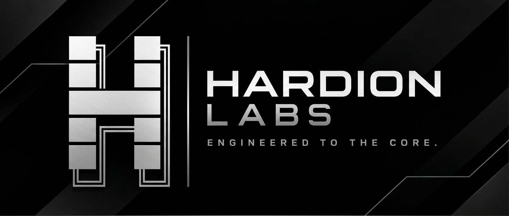

# HARDION LABS

### Independent Software Engineering

**Engineered to the core.**

Building high-performance software, systems, libraries, frameworks, and developer tools.

---

## About Us

Hardion Labs is an independent software engineering organization focused on designing and developing high-performance software with an emphasis on architectural quality, efficiency, and technical excellence.

We believe great software starts with a deep understanding of the problem and the systems behind it.

Our approach combines first-principles engineering, deliberate architecture, efficient resource management, and a commitment to building reliable, maintainable software.

## Engineering Philosophy

- **Performance First** — Treat computational efficiency, memory usage, and resource consumption as core design considerations.
- **Minimal Complexity** — Prefer simple, focused solutions over unnecessary abstractions and dependencies.
- **Engineering Excellence** — Prioritize correctness, consistency, and well-designed architectures.
- **First Principles** — Understand the underlying mechanisms instead of relying blindly on existing abstractions.
- **Long-Term Maintainability** — Build software that remains understandable, extensible, and reliable over time.
- **Open Source** — Encourage transparency, collaboration, and knowledge sharing.

## Areas of Focus

| Domain | Focus |
|:--|:--|
| Systems Engineering | Low-level programming, system architecture, and resource management |
| Software Infrastructure | Libraries, frameworks, and foundational components |
| Developer Tools | Development utilities, programming tools, and automation |
| Performance Engineering | Optimization, memory efficiency, and computational performance |
| UI Engineering | Efficient graphical interfaces and reusable UI infrastructure |

## Technology

Our technology choices are driven by engineering requirements and project objectives.

- C / C++
- Zig
- Linux and systems programming
- Computer architecture
- Performance-oriented development
- Open-source technologies

## Projects

Our repositories contain independent projects, each with its own goals, architecture, documentation, and development roadmap.

[**Explore Hardion Labs repositories →**](https://github.com/Hardion-Labs?tab=repositories)

## Contributing

We appreciate meaningful contributions, technical discussions, bug reports, and ideas that help improve our projects.

Before contributing, please review the guidelines and documentation provided in the respective repository.

We value contributions that prioritize:

- Technical quality and correctness.
- Clear and maintainable implementations.
- Measurable performance improvements.
- Thoughtful architectural decisions.
- Well-documented changes.

## Connect

- **GitHub:** [Hardion Labs](https://github.com/Hardion-Labs)
- **Email:** matheusprojectdev@proton.me

---

**HARDION LABS**

*Engineered to the core.*

